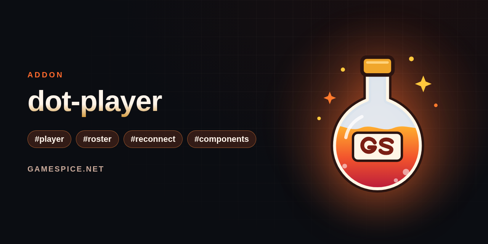

[](https://moddingcommunity.com/a/248-dot-player)

One shared record per player, so team, class, alive state and stats stop living in four separate dictionaries that disagree after a reconnect.

`DotPlayerRoster` holds the rows. `DotPlayer` is the node that represents a player in the scene. `DotPlayerComponent` is the base class other player addons extend.

## Install

1. Copy `addons/dot_player/` and `addons/dot_core/` into your project.
2. Enable both in *Project > Project Settings > Plugins*.

Needs Godot 4.7 or newer.

## Use

```gdscript
var roster := DotPlayerRoster.new()
roster.config = DotPlayerConfig.new()
add_child(roster)

roster.join("ada", "Ada", peer_id, tick)
roster.set_team("ada", &"blue")
roster.set_alive("ada", true)

# Once a tick or once a second: frees seats whose reconnect window is up.
roster.advance(tick)
```

On a client, use the same class with `authoritative = false`:

```gdscript
mirror.apply_wire(payload)   # the whole roster, on connect
mirror.apply_row(row)        # one changed row afterwards
```

A mirror decides nothing. Every change method on it fails with `CODE_FORBIDDEN`.

## Reconnecting

A dropped connection keeps the player's seat. Calling `join` with the same key inside the reconnect window is a rejoin: same record, team, score and join tick, new peer id. Set `reconnect_window_sec = 0` to remove players immediately, which suits a lobby. Held seats count towards `max_players` by default, so a stranger cannot take the seat of a player who is reconnecting.

## Settings

All in `DotPlayerConfig`, layered like every dot-core config (defaults, JSON file, environment, command line).

| Setting | Default | Meaning |
| --- | --- | --- |
| `max_players` | 0 | Player limit. 0 means unlimited. |
| `reconnect_window_sec` | 60 | How long a dropped player's seat is held. 0 removes immediately. |

## Nodes

`DotPlayer` extends `Node`, not a body, so it works in 2D and 3D and for players with no body (spectators, the dead, passengers). It finds its body and components in its children.

`DotPlayerComponent` finds its player by walking up the tree, so no `NodePath` is needed. Subclasses override `_on_bound` and `_on_unbound`, not `_ready`, because the key is assigned after `_ready`. `is_active()` checks the bind and the `local_only` rule.

| Class | Purpose |
| --- | --- |
| `DotPlayerRecord` | One player row: key, name, peer, team, class, character, alive, counters, metadata. |
| `DotPlayerRoster` | Joins, rejoins, held seats, expiry, stable key order. Authoritative on the server, mirrored on clients. |
| `DotPlayerConfig` | Capacity, reconnect window, name handling. |
| `DotPlayer` | The scene node. |
| `DotPlayerComponent` | Base class for player components. |

See [docs/design.md](docs/design.md) for details.

## Status and licence

Part of the [**GameSpice**](https://gamespice.net) platform: a family of Godot addons. Written with Claude Code and maintained by `gamemann`. Every addon has headless tests, but little of this has been played by real users yet, so expect rough edges and please [open an issue](https://github.com/gamespice-platform/player/issues) when you hit one.

MIT licence, see [LICENSE](LICENSE). The only closed part of the [**GameSpice**](https://gamespice.net) platform is the web back end; you can use your own instead of GameSpice's.
